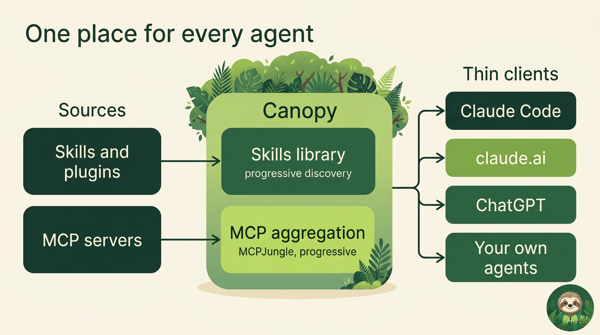
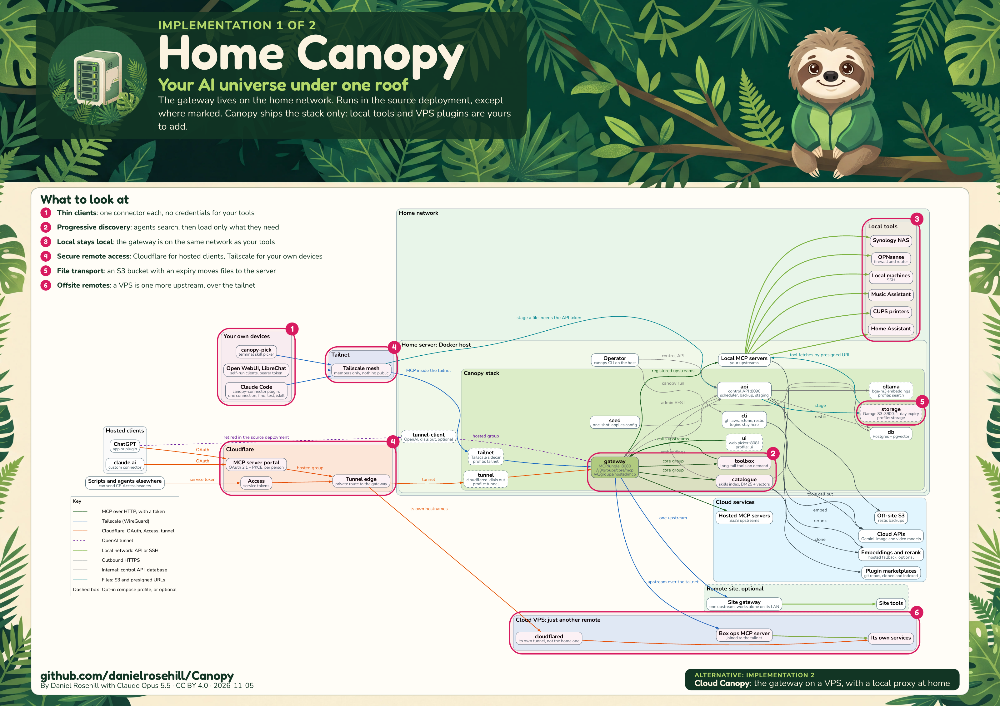
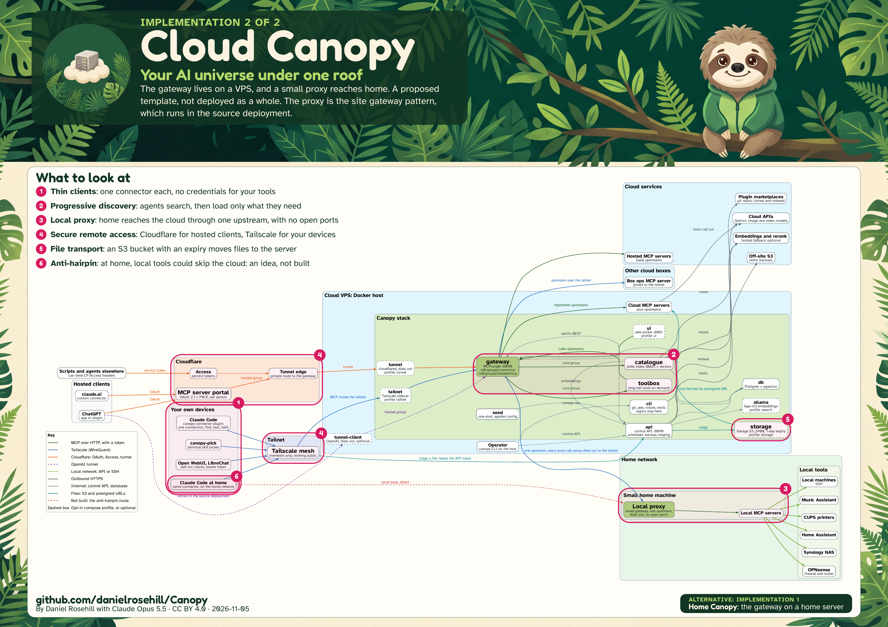

# Canopy

**Your AI universe under one roof.**

Unified progressive discovery for tools, plugins and skills. Self-hosted, for AI agents.

**Status: early. The core stack, control API, CLI, both pickers and the operations skills work. The
rest of the [target design](docs/design.md) is not built yet.**

## Why

I create plugins and skills every day, a lot of them, and on purpose. Defining a repeatable workflow is
immensely valuable, and it compounds: the more of them you have, the more you can do. Claude is very good at
writing them, so the library grows fast.

That only works if discovery stays lean. Everything an agent can use has to be described to it, so a big library
floods its context before any work starts. I hit this first with MCP tools, then again with skills.

The usual answer is project scope: decide that this repo needs tools A, B and C, and load only those. For a solo
developer that is the wrong trade. I don't want to curate a list per repo. I might need any tool, anywhere.

So the agent should start with almost nothing, search when it needs something, and load only what matches. That
is progressive discovery. For MCP, aggregation layers already do much of this, and they are good. But as I moved
from MCP towards skills, I found the blind spot: all the clever work in a tool like
[MCPJungle](https://github.com/mcpjungle/MCPJungle) doesn't help when the thing you have thousands of is skills.

I looked for something off the shelf that did this for skills and did not find it, so Canopy joins existing pieces
together: MCPJungle for tools, and a hybrid search index over your plugin marketplaces for skills, behind one search.
Tools, plugins and skills all stay out of the agent's context until it asks. It is not offered as the best way to do
this, just one way that works.



The aim is bundling, thin clients and context efficiency: clients hold one connector and no credentials for
your tools. Run it on a home server if you orchestrate a lot at home (Home Canopy), or on a VPS if you don't
(Cloud Canopy). The [overview](docs/overview.md) explains both, with diagrams.

## Deployment architectures

Every component and connection for each way of deploying Canopy. Click an image for the PDF. They are designed
as a pair of posters: [print notes](docs/diagrams/README.md).

### Architecture 1: Home Canopy

The gateway on a home server.

[](docs/diagrams/home-canopy.pdf)

[PDF](docs/diagrams/home-canopy.pdf) | Print-ready: [A1](docs/diagrams/home-canopy-print.pdf), [A0](docs/diagrams/home-canopy-print-a0.pdf)

### Architecture 2: Cloud Canopy

The gateway on a VPS, with a local proxy at home.

[](docs/diagrams/cloud-canopy.pdf)

[PDF](docs/diagrams/cloud-canopy.pdf) | Print-ready: [A1](docs/diagrams/cloud-canopy-print.pdf), [A0](docs/diagrams/cloud-canopy-print-a0.pdf)

## What you get

Canopy extends [MCPJungle](https://github.com/mcpjungle/MCPJungle), which it uses unmodified as the
MCP gateway. On top of that, `docker compose up -d` brings up:

- a **catalogue** that indexes the Claude Code plugin marketplaces you point it at, with keyword
  search out of the box and hybrid search if you add an embeddings endpoint
- a **toolbox** for calling long-tail tools without listing them all
- a **control API** and a `canopy` command for managing all of it, the only place that holds the
  gateway's admin token
- a **seed** service that applies your config through the API, and is safe to re-run
- a **cli** container with `gh`, `aws`, `rclone`, `restic` and others, so skills can use them without
  installing anything on the host

An agent connects to one small group of 12 tools. Skills and other tools stay out of its context
until it searches for them.

For people, there is a **skill picker**: fuzzy search across the skills and tools on your server, in
the terminal (`clients/canopy-pick`) and in a web UI (the `ui` profile).

Setting up and running Canopy has its own public Claude Code marketplace, published from this
repo. Its agent skills cover installing the stack and common operations, such as adding a
marketplace or triggering embeddings.

Apart from those operations skills, Canopy ships with no content of its own. You bring your own
marketplaces and MCP servers.

## Quick start

Needs Docker with Compose v2.

```bash
git clone https://github.com/danielrosehill/Canopy.git && cd Canopy
clients/canopy init             # makes ~/canopy/agent-data and ~/canopy/data
clients/canopy up               # ends with "seed finished with 0 problem(s)"
clients/canopy status
```

Link `clients/canopy` into your `PATH` to drop the prefix.

Connect Claude Code with the connector plugin. Set these before you start the session:

```bash
export CANOPY_MCP_URL=http://127.0.0.1:8080/v0/groups/core/mcp
export CANOPY_TOKEN=$(clients/canopy token)
```

```
/plugin marketplace add danielrosehill/Canopy
/plugin install canopy-connector@canopy
```

### Validate it

**Don't skip this step.** In a new session, ask your agent to validate Canopy, or run `/canopy-connector:validate`.
The agent checks the connection, then finds and loads a real tool and real skills, and reports what it cost.
An example, shortened, with illustrative timings:

```
ok    reach the gateway  36 ms
ok    list tools (12, ~2000 tokens)  25 ms
ok    tool:catalogue__health  rank 1  886 ms  ~368 + ~143 tokens
ok    skill:canopy-manager/setup  rank 1  548 ms  ~283 + ~400 tokens
retrieval  6/6 found, 6 first, median search 686 ms, median find and load ~700 tokens
GREEN: all tests OK, connection and retrieval working
```

Validating and benchmarking are one skill, because a connection only counts when an agent can retrieve through
it. Run it on each device you connect, and use it to measure any change to search: see
[the manual](docs/manual.md#validate-and-benchmark). A fresh server indexes only the Canopy plugins.

## Your own content

Two folders, kept outside the checkout. `CANOPY_AGENT_DATA` is yours, and `CANOPY_DATA` is Canopy's:

```
~/canopy/agent-data/   config/  skills/  notes/  cli/  secrets.env
~/canopy/data/         postgres/  catalogue/  api/  admin/  tokens/  backups/
```

In `agent-data/config`:

- `marketplaces.json` lists the marketplaces to index. The catalogue reads it on every sync.
- `servers.json` lists MCP upstreams and groups, with `${VAR}` placeholders filled from `secrets.env`.
  See `config/servers.example.json`. Run `canopy apply` after changing it.

All settings are described in `.env.example`.

## Manage it

The API listens on `127.0.0.1:8090`, and `canopy` is a client of it:

```bash
canopy status                       # every component in one reply
canopy servers                      # also groups, tools
canopy add-server upstream.json     # registers it, confirms by reading back, saves it to config
canopy remove-server NAME
canopy run gh repo list             # any command, in the cli container
canopy clis choose                  # pick tools for that container from the library
canopy api GET /v1/gateway/groups   # any route
```

## Find skills yourself

In the terminal, with only Python and no other dependencies:

```bash
export CANOPY_TOKEN=$TOKEN
clients/canopy-pick                       # type to filter, Enter to pick and copy the id
clients/canopy-pick --semantic "send an invoice"
clients/canopy-pick --kind tool --json dns
```

In the browser, at <http://127.0.0.1:8081>:

```bash
docker compose --profile ui up -d
```

Then hand the id to your agent with `/skill <id>` from the Canopy connector:

```
/plugin marketplace add danielrosehill/Canopy
/plugin install canopy-connector@canopy
```

## Profiles

| Profile | Adds | Tested |
| --- | --- | --- |
| (none) | gateway, Postgres, catalogue, toolbox, API, seed, cli | Yes |
| `ui` | Web UI | Yes |
| `search` | Ollama with bge-m3, with `EMBED_PROVIDER=local` | Not yet |
| `storage` | Garage: S3-compatible staging, `canopy stage FILE` | Yes |
| `tunnel` | Cloudflare Tunnel | Not yet |
| `tailnet` | Tailscale sidecar | Not yet |

## Security

The gateway runs in MCPJungle's enterprise mode, so every request needs a bearer token, and all ports
bind to 127.0.0.1. The API has its own token, needed in every mode. Anything run with `canopy run` can
read that token, so treat the `cli` container as an operator's shell. The web UI has no login of its own, so put it behind something that does before
exposing it.

The default `canopy-agent` identity can reach every upstream through the toolbox. To narrow that, use
a gateway allow-list or `TOOLS_GROUP`. A marketplace you add is content your agents will read and
follow, so add only sources you trust.

## Design notes

- [Overview](docs/overview.md): what Canopy is and why it is shaped this way, with diagrams
- [Network diagrams](docs/diagrams/README.md): the posters for both templates, and how to rebuild and print them
- [User manual](docs/manual.md): connecting a client, and how finding skills works
- [API reference](docs/api.md): every route
- [Architecture](docs/architecture.md): how the stack fits together
- [Hosted and web clients](docs/connect/saas-and-web-clients.md): ChatGPT, claude.ai, Open WebUI and others.
- [Deployment patterns](docs/deployment-patterns.md): remote access with Tailscale and Cloudflare,
  including hosted clients such as ChatGPT and claude.ai
- [Target design](docs/design.md): where this is heading, and the order of work
- [Private overlay](docs/private-overlay.md): keeping your own settings out of a Canopy checkout
- [MCP Deployment Architecture](https://github.com/danielrosehill/MCP-Deployment-Architecture): the
  conceptual notes behind this design

## Licence

MIT. MCPJungle is MPL-2.0 and runs as its unmodified upstream image.

The graphics in `docs/brand` and `docs/diagrams` are [CC BY 4.0](https://creativecommons.org/licenses/by/4.0/), by Daniel
Rosehill with Claude Opus 5.5. The fonts in `docs/diagrams/fonts` are under the SIL Open Font License.
