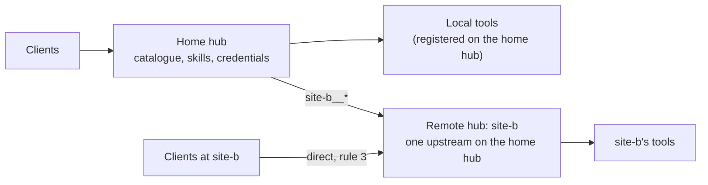

# Hubs: home and remote gateways

A **hub** is a gateway that serves one site: a house, an office or a VPS. Most setups need only one hub. A
second one is worth having only when a site has to keep working on its own (see [overview](overview.md#how-many-gateways)).
This page covers how two or more hubs relate to each other, and how to stop calls going the long way round.

Status, 2026-11-27: a remote hub is an ordinary upstream entry with a [`hub` block](#the-hub-block), which
`validate` checks and `apply` uses to catch loops and hairpins. None of the
anti-hairpin rules need code: they are rules about where you register things and where clients connect.

## Terms

| Term | Meaning |
| --- | --- |
| **Home hub** | The hub your clients connect to by default. It holds the catalogue, the skills and most credentials. In [Home Canopy](overview.md#home-canopy) it is on a home server. In [Cloud Canopy](overview.md#cloud-canopy) it is on a VPS. |
| **Remote hub** | A gateway at another site, registered on the home hub as **one upstream**. It may be a full Canopy, a small MCPJungle, or a local proxy. Its tools arrive double-prefixed: `<site>__<server>__<tool>`. |
| **Relationship** | One-way: *home registers remote*. The remote hub does not register the home hub back. A two-way pair is a loop (rule 2). |
| **Exposes** | What the remote hub serves on the endpoint the home hub uses. The remote hub decides this, with its own group or profile. The home hub can narrow it further, never widen it. |



## Registering a remote hub

One entry in `servers.json`, on the home hub:

```json
{
  "name": "site-b",
  "transport": "streamable_http",
  "description": "Site B (the beach house): its own hub. site-b__home-assistant__* is THAT house, not this one; site-b__shell__* is a root shell on its hub box.",
  "url": "https://mcp.site-b.example.com/mcp",
  "headers": {
    "CF-Access-Client-Id": "${SITE_B_CF_CLIENT_ID}",
    "CF-Access-Client-Secret": "${SITE_B_CF_SECRET}"
  }
}
```

- **Name it after the site**, not the software. The name becomes the first prefix of every tool.
- **Say which tools are the site's own** in the description, wherever a name could be mistaken for one at
  home (`home-assistant`, `shell`, a printer). Agents read the description to pick a tool.
- **Expose a group, not everything.** Point `url` at the remote hub's group endpoint (for MCPJungle,
  `/v0/groups/<group>/mcp`) when the home hub should not see all of it.
- **Use a tailnet URL where both ends are on the tailnet.** It skips Cloudflare and needs no Access token.
- **Add a [`hub` block](#the-hub-block)** so `validate` and `apply` know it is a hub.

A VPS with only a box-control server on it is not a hub. Register that server directly, as in
[overview](overview.md#home-canopy): "a VPS is just another offsite remote".

## Anti-hairpin rules

A hairpin is a call that leaves a site and comes back to it, or that goes through a hub it never needed.
It costs latency, it stops working when the far hub is down, and in a loop it does not end. Four rules:

### 1. Register a tool on the hub at its site

A server at home is registered on the home hub, directly, by its LAN or container address. It is never
reached only through a remote hub, even when the remote hub could also see it. If both hubs could hold the
same server, the hub on that server's network holds it.

Check: no upstream URL on the home hub points to a remote hub that in turn reaches a home address.

### 2. Relationships are a tree: never register a hub's parent

If the home hub registers `site-b`, `site-b` does not register the home hub, or anything that re-exports
it. Otherwise each lists the other's tools, prefixed again on every pass:
`site-b__home__site-b__…`. MCPJungle and the Canopy hub both copy whatever an upstream lists, so nothing
stops this but the config.

When the reverse direction is needed later (a remote site that wants a few home tools), give it a
**direct** entry for each home server it needs, never the home hub as a whole. Or put a narrow group on the
home hub that holds no remote hub, and register only that group.

Check: no tool name on any hub repeats a prefix (`a__…__a__…`).

### 3. A client connects to the hub at its own site

A client that lives at `site-b` gets its own connector to `site-b`'s hub, not only to the home hub. Calls to
`site-b`'s tools then stay at `site-b`, and they keep working when the link home is down. Give it a second
connector to the home hub only if it needs the catalogue or home's tools.

A thin client holds one connector, and this bends that a little ([overview](overview.md#thin-clients)). The
connector still holds no credentials for the tools, only a token for a hub, so the rule holds where it counts.

### 4. Away from home, reach a remote hub directly

A travelling client that calls a remote hub's tools pays for two hops through the home hub: client to home,
then home to the remote. The fix is the same as rule 3: a direct connector to the remote hub, over the
tailnet. It is worth doing only for sites you call often from far away. Discovery can stay on the home hub.

The Cloud Canopy case is this rule turned round: when the home hub is on a VPS, a client at home calling a
tool at home should go straight to the local proxy ([overview](overview.md#advanced-an-anti-hairpin-rule)).

### Auditing a deployment

1. Run `canopy hubs`: it lists loops and second routes it can see from tool names. Then list the home hub's
   upstream URLs (`canopy servers`, or `servers.json`). Each one that is a hub: confirm
   its own upstreams hold no address at the home site (rule 1) and no entry for the home hub (rule 2).
2. List the tool names on each hub and look for a repeated prefix (rule 2).
3. For each client, write down its site and its connectors. A client at a site with a hub should have a
   connector to that hub (rule 3).

## The `hub` block

Mark a remote hub's entry with a `hub` block, and name this hub's own site at the top of `servers.json`:

```json
{
  "site": "home",
  "servers": [
    {
      "name": "site-b",
      "transport": "streamable_http",
      "url": "https://mcp.site-b.example.com/mcp",
      "hub": {
        "role": "remote",
        "site": "site-b",
        "direct_url": "http://site-b-hub.tailnet.example:8080/mcp",
        "exposes": "household"
      }
    }
  ],
  "groups": []
}
```

| Field | Meaning |
| --- | --- |
| `site` (top level) | This hub's own site. Optional, but without it a loop back to this hub can only be caught by a repeated prefix. |
| `hub.role` | `remote`, the only value. A hub registers hubs at other sites, never its parent (rule 2). |
| `hub.site` | The remote site's name. Defaults to the entry's `name`. |
| `hub.direct_url` | Where a client at that site, or one away from home, reaches the hub without going through this one (rules 3 and 4). |
| `hub.exposes` | The group or profile the remote hub serves on `url`. Recorded, so a reader knows what the entry holds. |

The block is Canopy's own: it is taken off before the entry goes to the gateway.

What the stack does with it (since 2026-11-27):

- **`canopy validate`** refuses an unknown field, a role other than `remote`, a `direct_url` that is not
  http(s), two entries for the same site, and an entry whose site is this hub's own.
- **`canopy apply`** reads the tool names that came in through each hub, `<hub>__<server>__...__<tool>`,
  one prefix per hop:
  - a prefix that repeats, or a hop named after this hub's `site`, is a **loop** (rule 2). Apply reports
    it as a failure, `hub loop: ...`. It removes nothing: fix the remote hub's config.
  - a hop named after another hub registered here directly is a **second route** to that site (rule 1),
    the long way round. Apply reports it under `warnings`, `hub hairpin: ...`.
- **`canopy hubs`** (`GET /v1/gateway/hubs`) lists each hub with its site, `direct_url`, `exposes` and tool
  count, plus any loops and hairpins. Use it to set up the direct connectors in rules 3 and 4.

What it cannot see: rule 1 for an ordinary server. A remote hub's `home-assistant` and this hub's
`home-assistant` are usually two different houses, so a shared server name is not a duplicate, and a remote
hub's upstream URLs are not visible from here. Check those by hand (the audit above).

Not built yet: connector setup that offers `direct_url` on its own, and the catalogue saying which site a
hub's tools are at. Until then, write the site into the entry's `description`.

## Related

- [Overview: Home Canopy and Cloud Canopy](overview.md#home-canopy-and-cloud-canopy)
- [Federated upstreams](federation.md): one server for many accounts. Different from hubs: federation is
  many identities on one server, a hub is many servers at one site.
- [Deployment patterns](deployment-patterns.md): Tailscale and Cloudflare, the two ways a hub is reached
