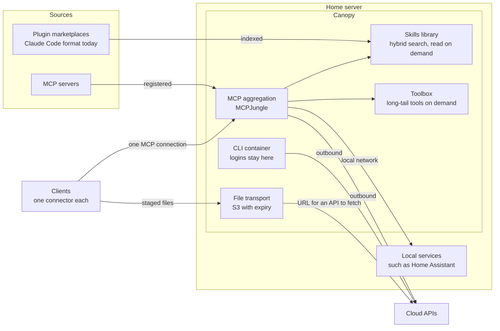
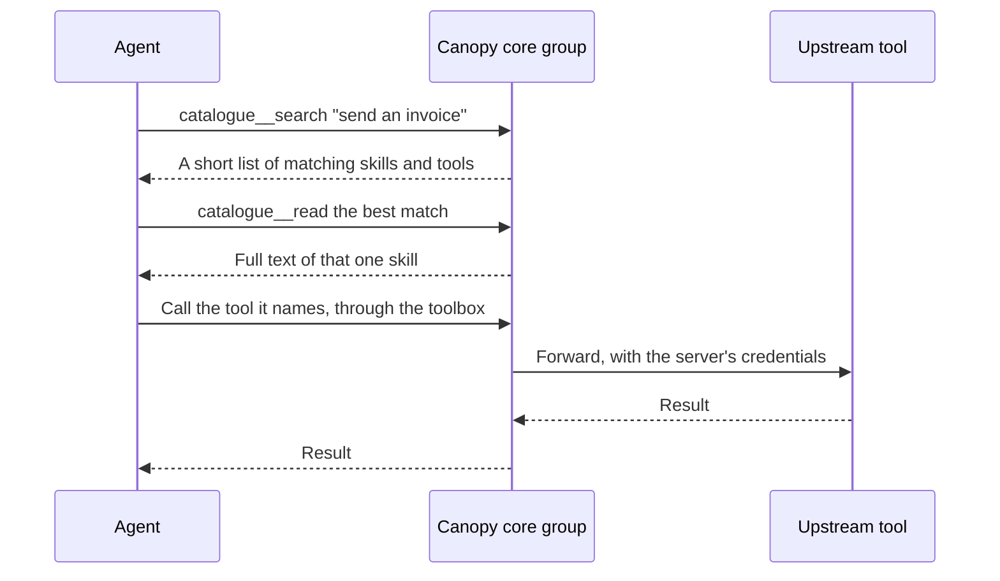
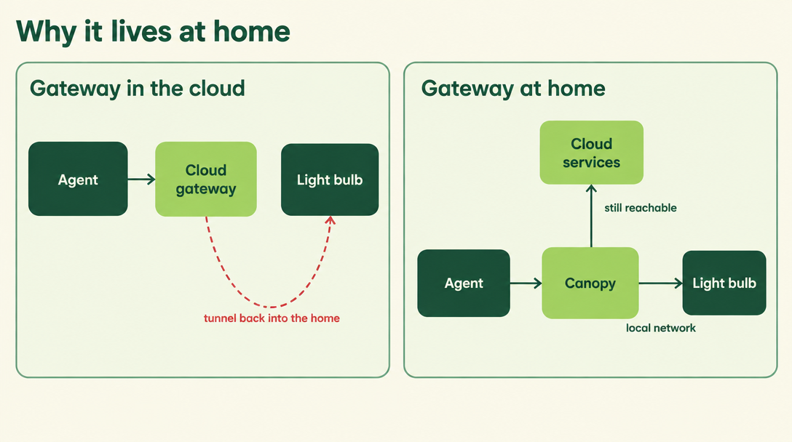
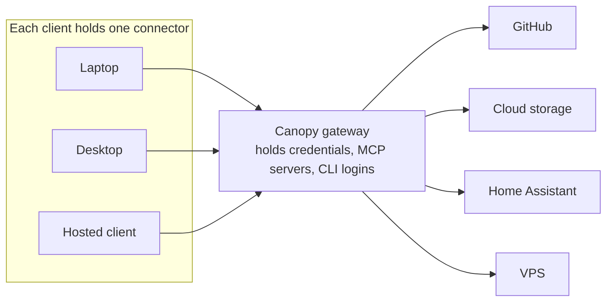
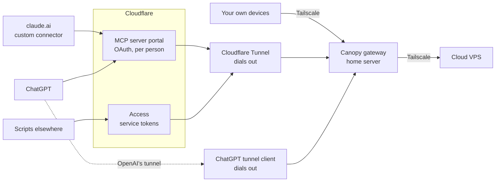
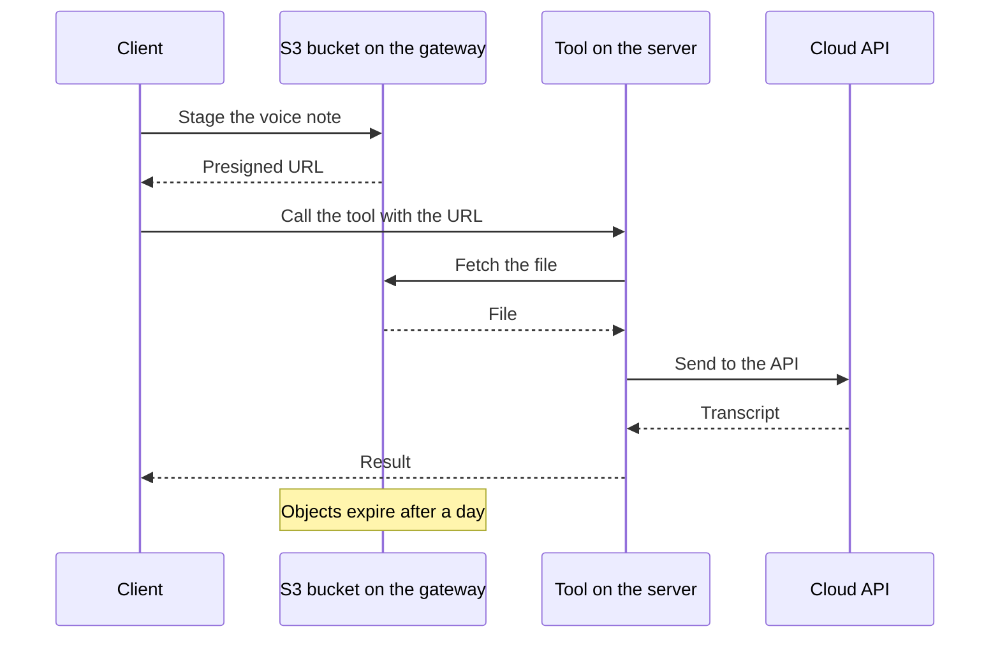

# Overview: what Canopy is and why it is shaped this way

The short version, with the reasoning. For the services and their behaviour see
[Architecture](architecture.md), and for where the design is heading see the [target design](design.md).

## The idea

A rainforest canopy is one roof over everything beneath it. Canopy is that for AI tooling: your skills,
plugins, MCP servers and CLIs live in one place, and every agent you use reaches them through one
connection.

It is mission control for your AI setup, and it normally sits on a home server.

## How it came about

I looked for something off the shelf that did all of this and did not find it. That is not a claim
that nothing else does. There are good tools for MCP, and Canopy uses one of them,
[MCPJungle](https://github.com/mcpjungle/MCPJungle), unmodified. What I did not find was real progressive
discovery for skills.

So Canopy joins existing pieces with the routes and connections between them. It is not offered as the best
way to do this. It is one way of making AI work day to day, written down so that others can take what is useful.

## The pieces

- **Skills library.** Indexes plugin marketplaces. Claude Code's format is the one supported today, but the
  idea is not tied to it. Skills stay out of the agent's context until a search finds them.
- **MCP aggregation.** MCPJungle puts all your upstreams behind one endpoint. This is progressive too: the
  agent sees a small `core` group of 12 tools, and reaches the long tail through the toolbox.
- **CLI container.** Tools such as `gh` and `aws`, with their logins, on the server.
- **File transport.** See [below](#file-transport).

## Progressive discovery

Thousands of skills and tools cannot all sit in a session's context, so an agent loads only what it
needs, when it needs it.

The [manual](manual.md#how-finding-skills-works) covers this from the user's side.

## Why it lives at home

Some tools are local by nature. Home Assistant is the plain example, though not an important one in itself.

Deploy the gateway in the cloud, and turning on a light bulb means an awkward tunnel from the cloud back
down into your house, with its latency, just to reach something on your own network. Deploy it at home, and
local tools are local while the cloud is still an ordinary outbound connection away. Direction matters:
going out from home is easy, and getting in is the hard part.

The cost is that the gateway depends on your home connection and power, so anything that must always be
up belongs elsewhere. Canopy itself only needs a Docker host, so a VPS works if you have no local tools.

## Thin clients

This is the principle the rest follows from. **Clients hold no MCP servers and no authentication for your
tools.** Each one has a single connector to the gateway, and the gateway makes every onward connection.

So a new device is one install, a new tool appears on every client at once, and
a login is renewed in one place. For Claude Code the connector is the `canopy-connector` plugin. Hosted
clients use the routes below.

The connector's reach is set on the server. By default `canopy-agent` can reach every upstream through the
toolbox, so narrow it as described under [Security](../README.md#security).

## Secure remote access

The key requirement: your tools have to work when you are away from home, without opening the home server
to the internet.

- **Tailscale** is the general-purpose route: your own devices, and cloud resources too. A VPS on the tailnet
  can be managed from Canopy, by adding an MCP server for the box and skills for running it. That is what
  makes this the control point for a small fleet. Canopy ships no VPS plugin, so you bring your own. The
  deployment Canopy came from runs one.
- **Cloudflare's MCP server portal** is the security layer for clients outside the tailnet. Hosted clients
  sign in with OAuth, each person as themselves, and the portal reaches the gateway over a private route.
- **The claude.ai connector** is a custom connector pointed at that portal.
- **ChatGPT** can use the same portal, or OpenAI's own tunnel, which dials out from beside the gateway.
- **Each hosted client gets its own gateway group,** holding only what it should see.

**Status:** these routes run in the deployment Canopy came from, except the ChatGPT tunnel, which that
deployment retired over a sharing limit. None has been run with Canopy's default enterprise mode yet, and the
`tunnel` and `tailnet` profiles are untested. Setup and known problems are in
[Deployment patterns](deployment-patterns.md) and [Hosted and web clients](connect/saas-and-web-clients.md).

## File transport

A small detail that thin clients make necessary. Tools run on the server, and files start on the client.

The friction first showed up with dictation: sending a voice note to Gemini did not work with the Gemini MCP
on the server, because the file had to get across before it could go to the API. Image-to-image and video
jobs then hit the same wall.

The answer is simple: an S3 bucket on the gateway with an expiry policy. The client drops the file there, gets
a presigned URL, and hands the URL to the tool. In the source deployment this has added very little latency.

In Canopy this is the `storage` profile: Garage, a `transient` bucket with a 1-day expiry, and `canopy stage FILE`.

Two limits today. Staging posts the file to the control API, so a remote device needs the API token and a
route to the API, not only its connector. And Garage accepted the expiry rule, but no deletion has been
observed yet, which is why the `storage-expiry` job checks for overdue objects. See
[Storage](architecture.md#storage).
