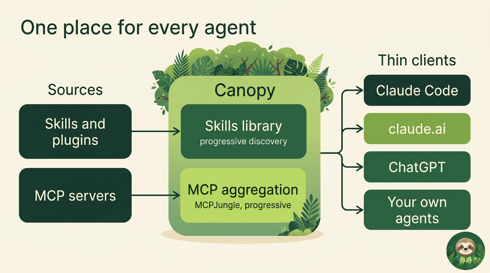
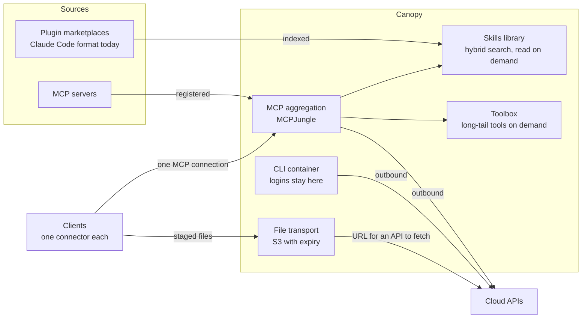
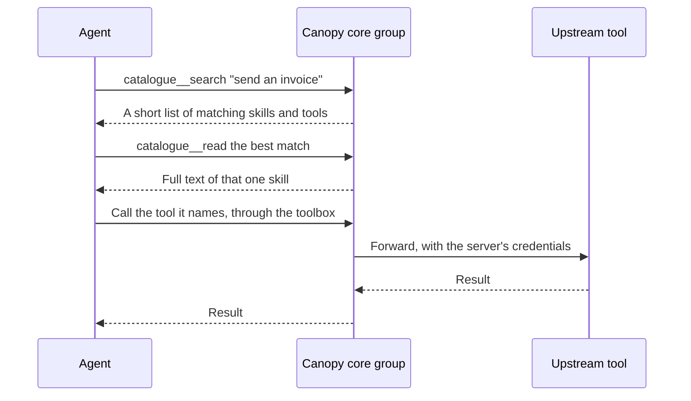
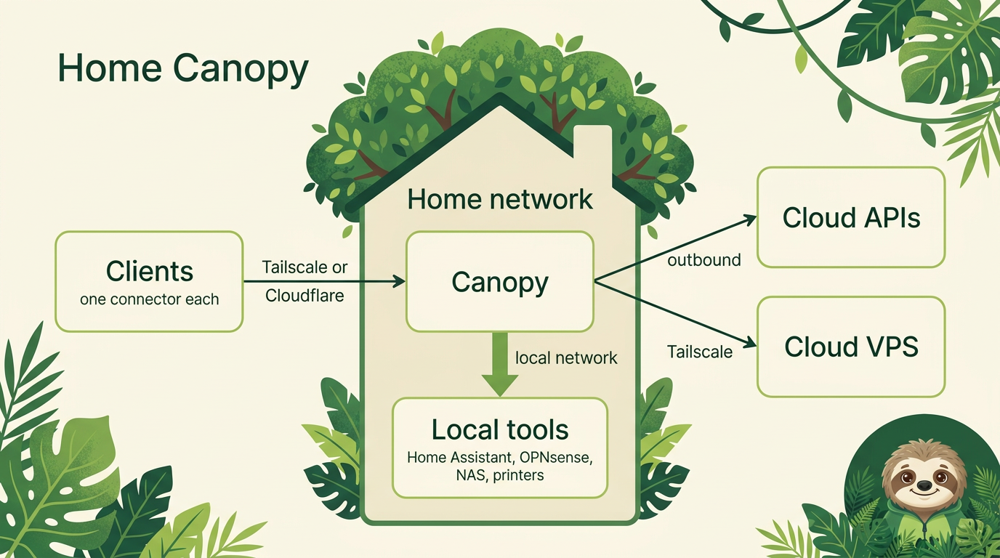
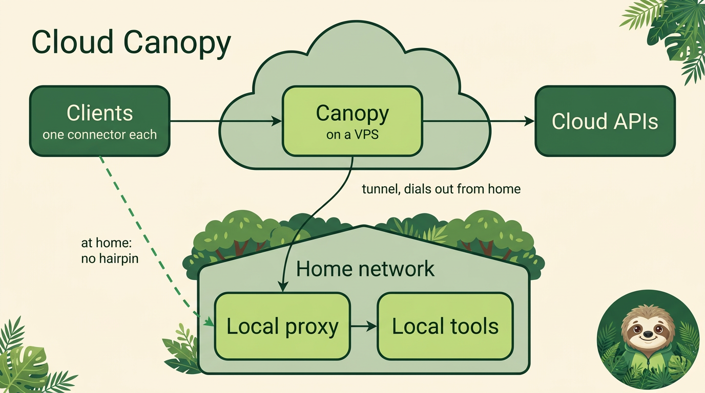
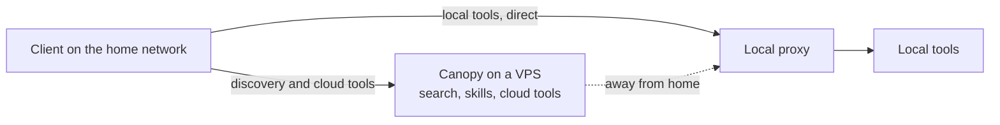
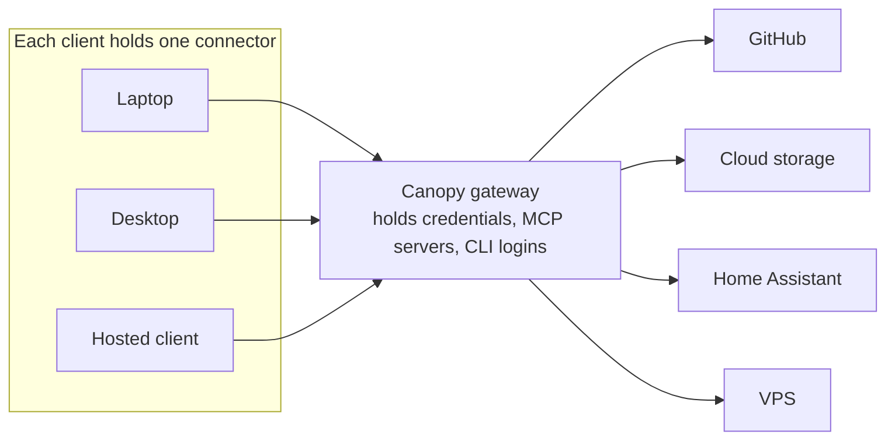
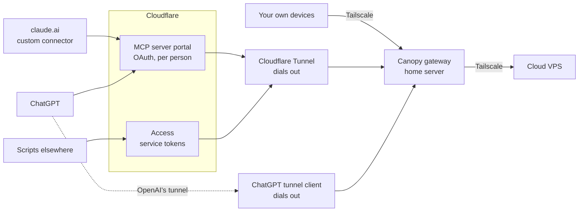
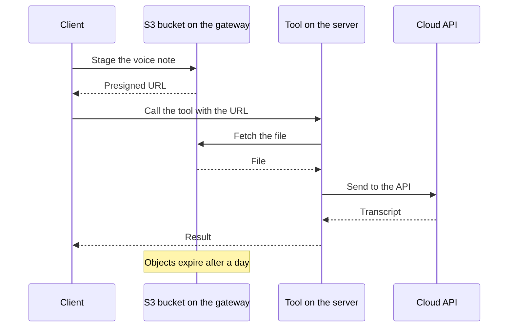

# Overview: what Canopy is and why it is shaped this way

The short version, with the reasoning. For the services and their behaviour see
[Architecture](architecture.md), and for where the design is heading see the [target design](design.md).

## The idea

A rainforest canopy is one roof over everything beneath it. Canopy is that for AI tooling: your skills,
plugins, MCP servers and CLIs live in one place, and every agent you use reaches them through one
connection.

The central objective has three parts:

- **Bundling.** Every component sits together, as mission control for your AI setup.
- **Thin clients.** A client holds one connector, and nothing else.
- **Context efficiency.** Agents load what they need, when they need it.

Where it runs is a separate choice: at home or in the cloud. See
[Home Canopy and Cloud Canopy](#home-canopy-and-cloud-canopy).

## How it came about

I looked for something off the shelf that did all of this and did not find it. That is not a claim
that nothing else does. There are good tools for MCP, and Canopy uses one of them,
[MCPJungle](https://github.com/mcpjungle/MCPJungle), unmodified. What I did not find was real progressive
discovery for skills.

So Canopy joins existing pieces with the routes and connections between them. It is not offered as the best
way to do this. It is one way of making AI work day to day, written down so that others can take what is useful.

## The pieces

- **Skills library.** Indexes plugin marketplaces. Claude Code's format is the one supported today, but the
  idea is not tied to it. Skills stay out of the agent's context until a search finds them.
- **MCP aggregation.** MCPJungle puts all your upstreams behind one endpoint. This is progressive too: the
  agent sees a small `core` group of 10 tools, and reaches the long tail through the toolbox.
- **CLI container.** Tools such as `gh` and `aws`, with their logins, on the server.
- **File transport.** See [below](#file-transport).

## Progressive discovery

Thousands of skills and tools cannot all sit in a session's context, so an agent loads only what it
needs, when it needs it.

The [manual](manual.md#how-finding-skills-works) covers this from the user's side.

## Home Canopy and Cloud Canopy

Bundling, thin clients and context efficiency are the point of Canopy, and none of them depends on where it
runs. So there are two templates, and both are valid. The question is where your orchestrator should sit,
and that comes down to how much of what you automate is at home.

The full network diagrams show every component and connection: [Home Canopy](diagrams/home-canopy.pdf) and
[Cloud Canopy](diagrams/cloud-canopy.pdf). The pictures below are the short version.

| | Home Canopy | Cloud Canopy |
| --- | --- | --- |
| Gateway runs on | A home server | A cloud VPS |
| Local tools | On the same network | Through a proxy at home |
| Cloud tools | Ordinary outbound calls | Ordinary outbound calls |
| Reaching it from outside | Needs a route in: Tailscale or a Cloudflare tunnel | Already outside, though it still needs a login in front |
| If home goes offline | Everything stops | Cloud tools keep working |
| Best when | You orchestrate a lot at home | You do little at home, or want it always up |

### Home Canopy

The gateway lives on a home server, and this is the deployment Canopy came from. There is something elegant
about it when a lot of your orchestration happens at home, because the tools are right there:

- SSH into local machines
- OPNsense for the firewall and router
- Synology for the NAS
- Home Assistant
- Printers on the home network through CUPS
- Music Assistant

Canopy ships none of these. They are examples of what you can add as plugins and MCP servers, and the source
deployment has each of them.

Put the gateway in the cloud with nothing at home, and turning on a light bulb means an awkward tunnel back
into your house. At home, local tools are local and the cloud is still an outbound connection away.

**A VPS is just another offsite remote.** It joins the tailnet, runs a small MCP server for operating the box,
and registers on the gateway as one more upstream. If it hosts public services of its own, it has its own
Cloudflare tunnel for those, separate from the tunnel into the home.

### Cloud Canopy

The inverse. If you don't do much at home, run the orchestrator on a VPS. It is always up, it does not depend
on your home connection, and you lose nothing unless you have local tools.

If you do have some, add a **local proxy**: a small gateway on a home machine that holds the local MCP
servers and connects out to the cloud, so that the home still has no open ports. Canopy registers the proxy as
one upstream, and all of its tools arrive through that one connection. The cost is that every local action now
makes a round trip through the cloud.

**Status:** Cloud Canopy has not been deployed as a whole. Its main building block has: the source deployment
runs a small gateway at a remote site, registered on the primary gateway as a single upstream, and it stays
usable on its own network. See [federated site gateways](https://github.com/danielrosehill/MCP-Deployment-Architecture#federated-remote-site-gateways).

#### Advanced: an anti-hairpin rule

A client that is at home, calling a tool that is at home, should not go out to the cloud and back. That is a
hairpin. The rule: **when a client is on the home network, local tools go straight to the proxy.**

Discovery can stay in the cloud, since only the tool call needs the shortcut. One way to do it is for the connector
to add a second connection to the proxy when it can see the proxy on the local network, and drop it
when it can't. That bends "one connector" a little, so it is worth doing only if local calls are frequent.
This is an idea, and it is not built.

### How many gateways?

One is enough for most setups, in either template. A second is worth it when a place has to keep working on
its own, as with the local proxy or a remote site. It is not needed just to reach a box you already own.

The source deployment learned this the hard way. It ran a second gateway on a VPS for its cloud boxes,
and removed it in July 2026. It was one more public MCP endpoint to secure, and its upstreams had drifted
out of date unnoticed. Registering the box directly over the tailnet did the same job.

Separate from gateways, you can run more than one Cloudflare portal in front of a single gateway, for example
one for shared tools and one that is private to you, each with its own gateway group.

## Thin clients

This is the principle the rest follows from. **Clients hold no MCP servers and no authentication for your
tools.** Each one has a single connector to the gateway, and the gateway makes every onward connection.

So a new device is one install, a new tool appears on every client at once, and
a login is renewed in one place. For Claude Code the connector is the `canopy-connector` plugin. Hosted
clients use the routes below.

The connector's reach is set on the server. By default `canopy-agent` can reach every upstream through the
toolbox, so narrow it as described under [Security](../README.md#security).

## Secure remote access

The key requirement: your tools have to work when you are away from home, without opening the home server
to the internet. This diagram is Home Canopy, as that is the one that runs today. Cloud Canopy needs the same
logins in front of it, and the tunnel runs the other way, out from the home proxy.

- **Tailscale** is the general-purpose route: your own devices, and cloud resources too. A VPS on the tailnet
  can be managed from Canopy, which makes it the control point for a small fleet. Canopy ships no VPS plugin,
  so you bring your own. The deployment Canopy came from runs one.
- **Cloudflare's MCP server portal** is the security layer for clients outside the tailnet. Hosted clients
  sign in with OAuth, each person as themselves, and the portal reaches the gateway over a private route.
- **The claude.ai connector** is a custom connector pointed at that portal.
- **ChatGPT** can use the same portal, or OpenAI's own tunnel, which dials out from beside the gateway.
- **Each hosted client gets its own gateway group,** holding only what it should see.

**Status:** these routes run in the deployment Canopy came from, except the ChatGPT tunnel, which that
deployment retired over a sharing limit. None has been run with Canopy's default enterprise mode yet, and the
`tunnel` and `tailnet` profiles are untested. Setup and known problems are in
[Deployment patterns](deployment-patterns.md) and [Hosted and web clients](connect/saas-and-web-clients.md).

## File transport

A small detail that thin clients make necessary. Tools run on the server, and files start on the client.

The friction first showed up with dictation: sending a voice note to Gemini did not work with the Gemini MCP
on the server, because the file had to get across before it could go to the API. Image-to-image and video
jobs then hit the same wall.

The answer is simple: an S3 bucket on the gateway with an expiry policy. The client drops the file there, gets
a presigned URL, and hands the URL to the tool. In the source deployment this has added very little latency.

In Canopy this is the `storage` profile: Garage, a `transient` bucket with a 1-day expiry, and `canopy stage FILE`.

Two limits today. Staging posts the file to the control API, so a remote device needs the API token and a
route to the API, not only its connector. And Garage accepted the expiry rule, but no deletion has been
observed yet, which is why the `storage-expiry` job checks for overdue objects. See
[Storage](architecture.md#storage).
