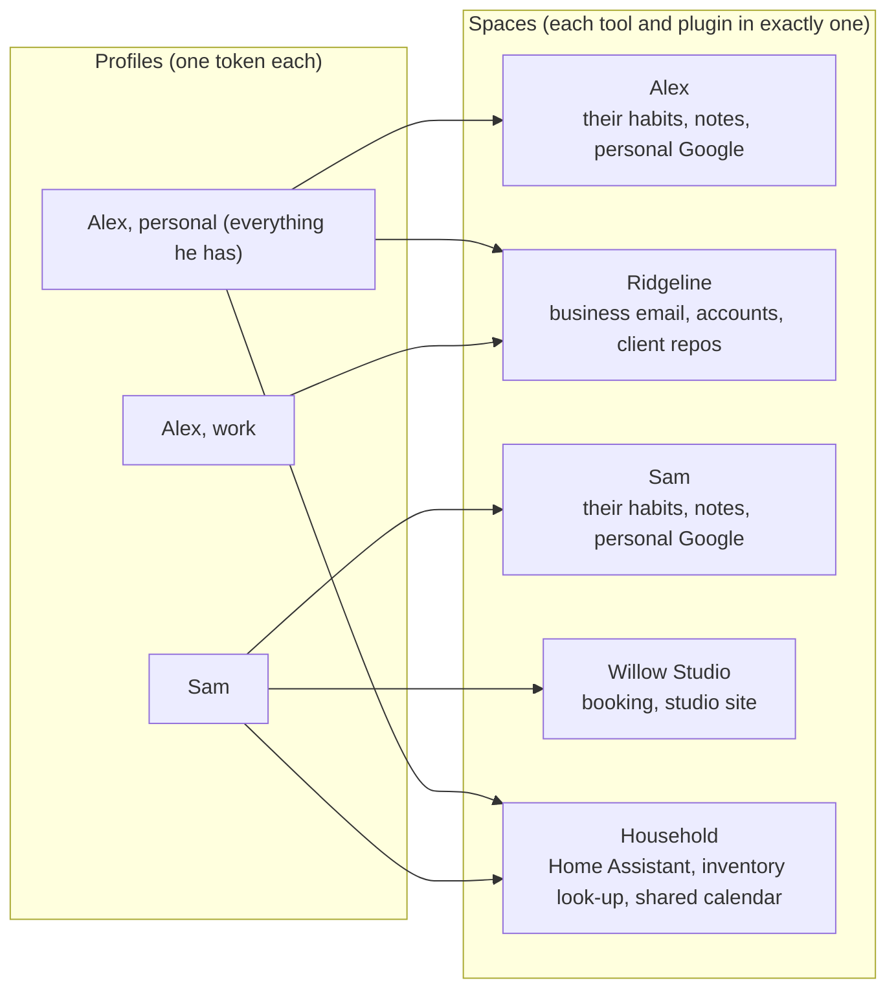

# Spaces: who sees what

Decided 2026-11-15. **Status: prototype.** `src/canopy/spaces.py` reads the config below and
`src/canopy/front.py` serves it, both tested but not yet a compose service. The shipped stack still scopes a
catalogue by `CATALOGUE_MARKETPLACES` and `CATALOGUE_SERVERS`, one profile set by hand, and the gateway still
uses MCPJungle groups. Spaces replace both, as part of the hub
([design](design.md#replacing-mcpjungle-with-the-hub)).

Canopy treats tools and plugins alike, and shares them the same way. What is shared is a **tool** or a
**plugin**, not a server or a machine: one server often holds tools for everyone and tools for its admin
alone. An inventory server can let both people look things up while only one can change stock; a box-control
server on a machine is admin, whoever lives in the room it sits in.

## An example household

Two people at home, each with a small business. Every name here is made up.

| | Who | Kind |
| --- | --- | --- |
|  | **Alex** | Person |
|  | **Ridgeline**, Alex's business | Organisation |
|  | **Sam**, Alex's partner | Person |
|  | **Willow Studio**, Sam's business | Organisation |
|  | **Household**, what both use | Shared |

Most things are private to one of them. A few are useful to both, like Home Assistant. This setup isn't an
enterprise: two people, two small businesses, one house.

## Four rules

1. **A space is the only container.** Each row above is a space, and so is `common` (below). Spaces don't nest. A business
   "attached" to a person is just a space whose only member is that person.
2. **Every tool and every plugin belongs to exactly one space.** A space claims them by name or by pattern
   (`home-assistant__*` is a whole server), and a whole marketplace by name. Whatever nobody claims belongs
   to the operator. If two people need something, it goes in a shared space; it isn't copied.
3. **A profile is a person plus some of their spaces.** A token is issued to a profile. A person can have
   several profiles, for example personal and work, and can only include spaces they're a member of.
4. **What a profile sees is the union of its spaces.** There are no overrides, deny lists or inheritance.
   Something outside the profile looks the same as something that doesn't exist.

Credentials stay with the server, in Canopy, whichever spaces its tools are in. Neither person's client holds
the Home Assistant token; a profile without Household can't reach its tools, and a profile with it reaches
only the tools Household claims.

## The household as spaces and profiles



| Space | Members | Claims |
| --- | --- | --- |
| `alex` | Alex | Nothing listed: everything unclaimed, which includes all admin (machines, NAS, firewall), their context volume and the inventory's write tools |
| `ridgeline` | Alex | `business-mail__*`, `accounts__*`, the business's marketplace |
| `sam` | Sam | Their context volume (`sam-notes`), `sam-mail__*` |
| `willow` | Sam | `booking__*`, `studio-site__*` |
| `household` | Alex, Sam | `home-assistant__*`, `inventory__search_items`, `inventory__get_*`, `calendar-home__*`, the household marketplace |
| `common` | Everyone | Keyless, harmless utilities: `time__*`, `fx__*`, docs lookup |

| Profile | Person | Spaces | New notes and memories go to |
| --- | --- | --- | --- |
| `alex` | Alex | `alex`, `ridgeline`, `household`, `common` | `alex` |
| `alex-work` | Alex | `ridgeline`, `common` | `ridgeline` |
| `sam` | Sam | `sam`, `willow`, `household`, `common` | `sam` |

Which spaces go in which profile is the user's choice. Alex's personal profile sees everything he belongs to;
their work profile is a strict subset for a business-only client, so home and personal tools stay out of business
sessions. A profile writes to its first space unless told otherwise. Writing to Household is a deliberate act,
never the default.

`common` is how a harmless utility reaches every profile without breaking rule 2. Leave out anything with a
key that costs money or reaches private data: that belongs to whoever owns the key.

## Config

One file, `agent-data/config/spaces.json`. `servers.json` and `marketplaces.json` don't change: placement
lives in one place, so it reads as a whole.

```json
{
  "operator": "alex",
  "spaces": {
    "alex":    {"members": ["alex"]},
    "ridgeline": {"members": ["alex"], "tools": ["business-mail__*", "accounts__*"],
                  "marketplaces": ["ridgeline-skills"]},
    "sam":    {"members": ["sam"], "tools": ["sam-mail__*"], "plugins": ["sam-notes"]},
    "willow":    {"members": ["sam"], "tools": ["booking__*", "studio-site__*"]},
    "household": {"members": ["alex", "sam"],
                  "tools": ["home-assistant__*", "inventory__search_items", "inventory__get_*", "calendar-home__*"],
                  "marketplaces": ["household-skills"]},
    "common":    {"members": ["alex", "sam"], "tools": ["time__*", "fx__*"]}
  },
  "profiles": {
    "alex":      {"person": "alex", "spaces": ["alex", "ridgeline", "household", "common"]},
    "alex-work": {"person": "alex", "spaces": ["ridgeline", "common"]},
    "sam":      {"person": "sam", "spaces": ["sam", "willow", "household", "common"]}
  }
}
```

How a name finds its space, first match wins:

1. an exact tool or plugin name;
2. the longest matching pattern (`inventory__get_*` beats `inventory__*`); a tie goes to the space listed first;
3. for a plugin, a claimed marketplace (a context source is a plugin of the `context` marketplace, so it is
   claimed by name);
4. the operator's space.

A tool that appears later, on a server that adds one, lands by the same rules at once: there is nothing to
re-register. With no `spaces.json` there is one profile that sees everything, so a single-user install
doesn't change.

Validation refuses:
- a profile that names a space its person isn't a member of, or an unknown space;
- the same exact name, or the same pattern, claimed by two spaces;
- a space with no members, or no space named after the operator.

## Accounts: one server, several keys

Newsletters, mailboxes and phone numbers are the common case: one MCP server, several accounts, each just a
different key. Some are one person's, some the business's, some the household's. Running a copy of the server
per account and per person would be silly, so a server lists its accounts and spaces claim them:

```json
{"name": "buttondown", "transport": "stdio", "command": "...",
 "accounts": {"personal": {"env": {"BUTTONDOWN_API_KEY": "${BD_PERSONAL}"}},
              "business": {"env": {"BUTTONDOWN_API_KEY": "${BD_BUSINESS}"}},
              "family":   {"env": {"BUTTONDOWN_API_KEY": "${BD_FAMILY}"}}}}
```

```json
"household": {"tools": ["buttondown__*"], "accounts": ["buttondown:family"]},
"ridgeline": {"accounts": ["buttondown:business"]}
```

- **Two questions, answered separately.** Tools say what a profile can do; accounts say as whom. Both resolve
  like tools (exact, longest pattern, then the operator's), so an unclaimed account is the operator's.
- **The agent sees one set of tools,** and `call_tool` takes `account` beside the tool's own arguments.
  With one usable account, or a profile default (`"defaults": {"buttondown": "personal"}`), it can leave it
  out. An account the profile doesn't have answers like one that doesn't exist, and a server where it has
  none is not listed, nor are its tools found by search.
- **Two ways to run it.** A server that reads its key at start gets one session per account, started on that
  account's first call. A server that takes the account per call (`"account_argument": "user_google_email"`,
  accounts `{"value": "..."}`) gets one session, and the hub sets that argument itself; a caller who sets it
  differently is refused.

## How it maps onto the parts

- **Hub:** the profile's test on a tool name (`Profile.allows_tool`) is the hub's `allow`, for listing and
  calling, and `Profile.accounts_for` and `default_account` pick the account. `list_servers` counts only the tools the profile has; a server that is down is listed if one of
  the profile's names or patterns could match one of its tools.
- **Catalogue:** the front door sends the placement and the profile's spaces; the catalogue resolves them
  against its own plugin and tool lists (`spaces.resolve_scope`) into a `retrieval.Scope`, set per request
  with `use_scope`, for search, read, list and `skills/list`.
- **Front door:** one MCP endpoint. The bearer token (`profile-<name>.token`, made on first start) picks the
  profile, and every client gets the same five tools, so nobody's tool list grows with what they can reach.
- **Context and memory:** a context volume is a plugin, so it has a space like anything else. Memory
  namespaces will get a space the same way (not built).
