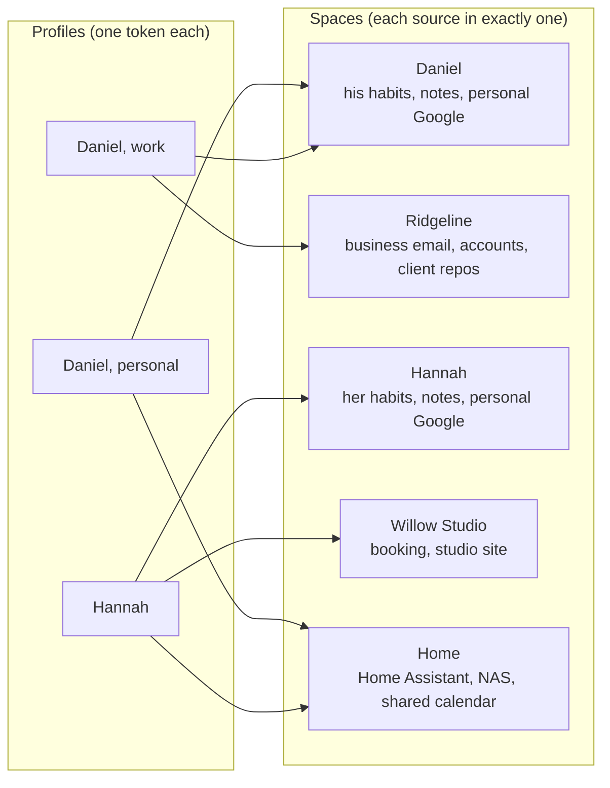

# Spaces: who sees what

Decided 2026-11-15. **Status: design.** Nothing here is built yet. Today a catalogue is scoped by
`CATALOGUE_MARKETPLACES` and `CATALOGUE_SERVERS` (`src/canopy/retrieval.py`), which is one profile set by
hand, and the gateway uses MCPJungle groups. Spaces replace both, as part of the hub
([design](design.md#replacing-mcpjungle-with-the-hub)).

Canopy treats an MCP server and a plugin marketplace as the same kind of thing: a **source**, with tools or
skills nested inside it. Sharing works the same way for both, so one model covers them.

## The household this was designed for

Two people at home, each with a small business. The business names here are made up.

| | Who | Kind |
| --- | --- | --- |
|  | **Daniel** | Person |
|  | **Ridgeline**, Daniel's business | Organisation |
|  | **Hannah**, Daniel's wife | Person |
|  | **Willow Studio**, Hannah's business | Organisation |
|  | **Home**, what both use | Shared |

Most things are private to one of them. A few are useful to both, like Home Assistant. This setup isn't an
enterprise: two people, two small businesses, one house.

## Four rules

1. **A space is the only container.** Each of the five rows above is a space. Spaces don't nest. A business
   "attached" to a person is just a space whose only member is that person.
2. **Every source belongs to exactly one space.** An MCP server, a marketplace or a context volume is never in
   two. If two people need it, it goes in a shared space. It isn't copied.
3. **A profile is a person plus some of their spaces.** A token is issued to a profile. A person can have
   several profiles, for example personal and work, and can only include spaces they're a member of.
4. **What a profile sees is the union of its spaces.** There are no overrides, deny lists or inheritance.
   Something outside the profile looks the same as something that doesn't exist.

Credentials go with the source, so the Home Assistant token sits in Home. Neither person's client holds it,
and a profile without Home can't reach it.

## The household as spaces and profiles



| Space | Members | Example sources |
| --- | --- | --- |
| `daniel` | Daniel | His context volume (habits, SOPs), personal Google, his own marketplaces |
| `ridgeline` | Daniel | Business Google, accounting, the business's marketplace |
| `hannah` | Hannah | Her context volume, her personal Google |
| `willow` | Hannah | Booking system, studio website |
| `home` | Daniel, Hannah | Home Assistant, NAS, shared calendar, household skills |

| Profile | Person | Spaces | New notes and memories go to |
| --- | --- | --- | --- |
| `daniel` | Daniel | `daniel`, `home` | `daniel` |
| `daniel-work` | Daniel | `daniel`, `ridgeline` | `daniel` |
| `hannah` | Hannah | `hannah`, `willow`, `home` | `hannah` |

Which spaces go in which profile is the user's choice. Daniel's work profile keeps `daniel`, so his own
habits apply at work too. It leaves `home` out, so home automation tools stay out of business sessions. A
profile writes to its person's own space unless it names another one. Writing to Home is a deliberate act,
never the default.

## Planned config

The `space` key will be added to the existing source configs (`config/servers.json`,
`config/marketplaces.json`), and one new file will name the spaces and profiles. A source with no `space`
key belongs to the operator's own space. With no `spaces.json`, everything is one space, so a single-user
install doesn't change.

```json
{
  "operator": "daniel",
  "spaces": {
    "daniel":    {"members": ["daniel"]},
    "ridgeline": {"members": ["daniel"]},
    "hannah":    {"members": ["hannah"]},
    "willow":    {"members": ["hannah"]},
    "home":      {"members": ["daniel", "hannah"]}
  },
  "profiles": {
    "daniel":      {"person": "daniel", "spaces": ["daniel", "home"]},
    "daniel-work": {"person": "daniel", "spaces": ["daniel", "ridgeline"]},
    "hannah":      {"person": "hannah", "spaces": ["hannah", "willow", "home"]}
  }
}
```

```json
{"name": "home-assistant", "space": "home", "transport": "streamable_http", "url": "...", "bearer_token": "${HA_TOKEN}"}
```

Validation will refuse:
- a profile that names a space its person isn't a member of;
- a source in an unknown space;
- two sources with the same name.

## How it maps onto the parts

- **Hub:** a profile's servers are its `scope` (`Hub.tools(scope)`, `Hub.call(..., scope=)`), which is
  already built.
- **Catalogue:** a profile's marketplaces and servers fill `retrieval.scope()`, which already scopes both
  kinds. This replaces the env vars with a per-request value.
- **Front door:** one MCP endpoint. The bearer token picks the profile, and the profile sets the scope for
  search, read, `skills/list` and `call_tool`.
- **Context and memory:** a context volume is a source, so it has a space like anything else. Memory
  namespaces get a space the same way.
